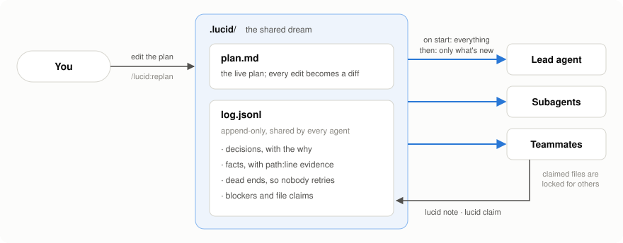
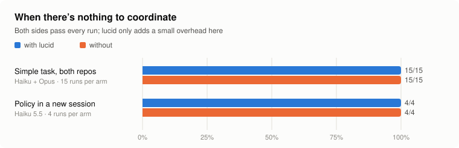
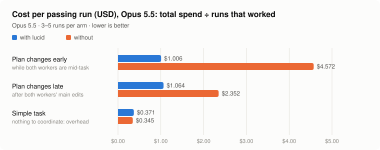
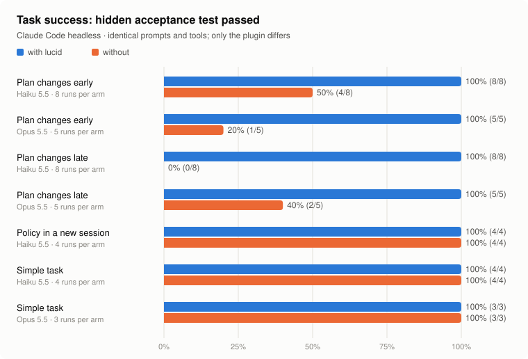
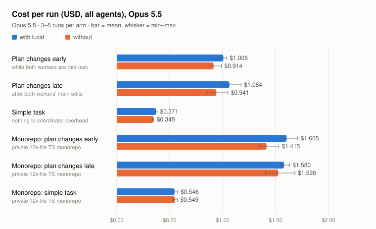
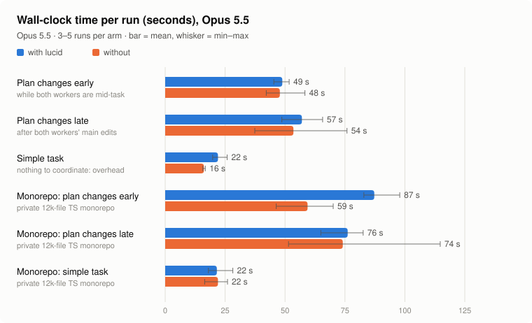
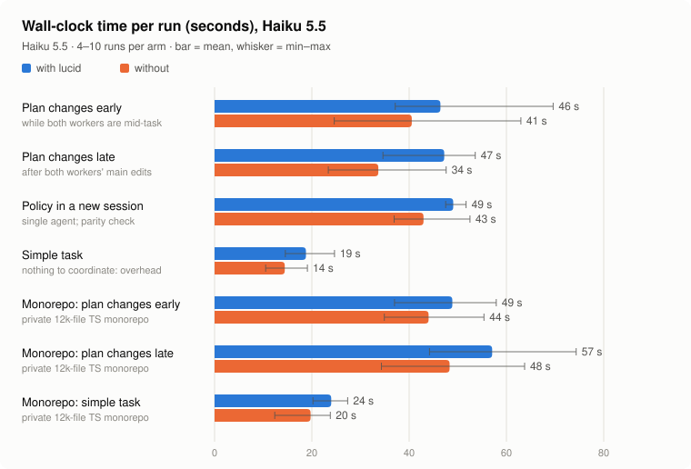

<p align="center">
  
</p>

<h1 align="center">lucid</h1>

<p align="center">
  <b>One shared dream for every Claude.</b><br>
  A live plan, an evidence-backed memory and file claims shared by the lead agent, its subagents and Agent-Teams teammates.<br>
  Change the plan partway through and every running worker sees the change before its next action.
</p>

<p align="center">
  <a href="https://lucid.meertarbani.in"></a>
  <a href="https://code.claude.com/docs/en/plugins/overview"></a>
  
  
  <a href="https://github.com/Redskull-127/lucid/actions/workflows/test.yml"></a>
  <a href="LICENSE"></a>
</p>

<p align="center">
  <a href="#-install">Install</a> ·
  <a href="#-how-it-works">How it works</a> ·
  <a href="#-benchmark">Benchmark</a> ·
  <a href="#-commands">Commands</a> ·
  <a href="#-seen-in-a-real-run">Real run</a> ·
  <a href="#-honest-limits">Limits</a>
</p>

---

## 🌙 The problem

You build a feature with several Claude agents working at once, then change your mind partway through. Things go wrong:

| Symptom | Why it happens |
|---|---|
| 🧭 **Plan drift** | Workers that are already running still follow the plan they were spawned with. Nothing tells them it changed. |
| 📉 **Lossy handoffs** | A subagent's summary leaves out the *why*, and leaves out the *"we tried X, it broke"*. |
| 🔁 **Repeated work** | Every worker re-reads and re-searches the same code. |
| 🫥 **Compaction amnesia** | Decisions disappear when the conversation is compacted and in new sessions. |
| 💥 **Overwritten work** | Two agents edit the same file and one loses its changes. |

## ✨ What lucid does

lucid gives every agent in the project **one shared memory**, the dream, kept as plain files in `.lucid/`:

| File | What it holds |
|---|---|
| `plan.md` | **The live plan.** When anyone edits it, every running agent gets the diff before its next tool call. |
| `log.jsonl` | **An append-only memory:** decisions (with why), facts (with `path:line` evidence), dead ends, blockers and file claims. |
| `digest.md` | **A consolidated summary**, written when you run `/lucid:dream`. |

The memory is wired in through hooks, so agents can't forget to check it. Agents only add to the log and never rewrite it. A fact whose cited code has changed is flagged **⚠stale**, so shared memory doesn't spread outdated claims.

## 🔭 How it works

<picture>
  <source media="(prefers-color-scheme: dark)" srcset="assets/how-it-works-dark.svg">
  
</picture>

| Hook | What it does |
|---|---|
| **SessionStart** (also after `/compact`) · **SubagentStart** | Injects the plan, the live memory and active claims, within a fixed budget. Subagents and Agent-Teams teammates start with the full shared context instead of a one-paragraph brief. |
| **UserPromptSubmit** · **PreToolUse** | Injects only what *other* agents wrote since you last looked. When nothing changed it injects nothing and costs no tokens. |
| **PreToolUse** on edits | 🔒 Blocks a write to a file another active agent has claimed, whether it goes through Edit/Write or through Bash (`>`, `sed -i`, `cp`/`mv`, scripts that `open(…, 'w')`). |
| **PreToolUse** on Bash | Adds the calling agent's real id to every `lucid` command, so every entry records who wrote it and agents never have to manage ids. |
| **SubagentStop** · **TaskCompleted** | Asks once for notes from an agent that edited files but logged nothing. A stopping subagent's claims are released. |
| **Stop** · **SessionEnd** | Releases a session's claims when its turn or the session ends, so an idle agent never blocks others. |
| **UserPromptSubmit** while workers are busy | Reminds the lead to write a chat change of plan into `plan.md` first, so running workers get it and it survives `/compact`. |

> lucid stays **inactive** until a project opts in with `lucid init`. In every other project a tiny shell guard checks for `.lucid/` and exits without starting Python. It works from repo subfolders and git worktrees, which share the main checkout's dream.

## 📊 Benchmark

The same tasks run **with and without lucid**, on **Claude Haiku 5.5 and Claude Opus 5.5** through headless `claude -p`, in two codebases: a small demo repo and a **private 12k-file, ~950k-line TypeScript monorepo**. Everything else is identical: the prompts, the tools, a fresh checkout per run, and project settings only (no personal plugins, hooks or CLAUDE.md). A hidden acceptance test the agents never see scores the final code. The 146 runs shown cost $58.77 in total.

<picture>
  <source media="(prefers-color-scheme: dark)" srcset="assets/bench-headline-dark.svg">
  
</picture>

<picture>
  <source media="(prefers-color-scheme: dark)" srcset="assets/bench-parity-dark.svg">
  
</picture>

- **Plan changes early:** two workers run in parallel, and you edit `PLAN.md` at the first worker edit.
- **Plan changes late:** the same, but the edit lands after both workers' main edits.
- **Policy in a new session:** session 1 hears an unwritten policy, and a fresh session 2 must follow it.
- **Simple task:** one agent, nothing to coordinate. This measures the overhead.
- **Monorepo rows:** the same design in the private monorepo, with the two workers editing modules in two different packages. The repo isn't named and no code from it is published.

| Scenario | Model | with lucid | without |
|---|---|---|---|
| Plan changes early | Haiku 5.5 | **8/8** · $0.031 | 4/8 · $0.030 |
| | Opus 5.5 | **5/5** · $1.01 | 1/5 · $0.91 |
| Plan changes late | Haiku 5.5 | **8/8** · $0.033 | **0/8** · $0.026 |
| | Opus 5.5 | **5/5** · $1.06 | 2/5 · $0.94 |
| Policy in a new session | Haiku 5.5 | 4/4 · $0.024 | 4/4 · $0.022 |
| Simple task | Haiku 5.5 | 4/4 · $0.011 | 4/4 · $0.009 |
| | Opus 5.5 | 3/3 · $0.37 | 3/3 · $0.35 |
| Monorepo: plan changes early | Haiku 5.5 | **8/8** · $0.045 | 2/8 · $0.043 |
| | Opus 5.5 | **5/5** · $1.60 | **0/5** · $1.42 |
| Monorepo: plan changes late | Haiku 5.5 | **10/10** · $0.053 | 2/10 · $0.044 |
| | Opus 5.5 | **5/5** · $1.58 | 1/5 · $1.53 |
| Monorepo: simple task | Haiku 5.5 | 5/5 · $0.019 | 5/5 · $0.017 |
| | Opus 5.5 | 3/3 · $0.55 | 3/3 · $0.55 |

Cells show runs passed and mean cost per run.

<picture>
  <source media="(prefers-color-scheme: dark)" srcset="assets/bench-costpass-opus-dark.svg">
  
</picture>

<picture>
  <source media="(prefers-color-scheme: dark)" srcset="assets/bench-costpass-haiku-dark.svg">
  
</picture>

**What it shows**
- **Plan changes mid-build: 54/54 with lucid, 12/54 without, across both models and both codebases.** Without lucid, Haiku missed every late change in the demo repo (0/8). Opus did better by re-checking the plan at the end (2/5), but still missed most changes. With lucid, the diff arrives before each worker's next tool call.
- **It holds in a large real codebase.** In the private 12k-file monorepo, workers without lucid missed the mid-task change in 23 of 28 runs, and with lucid all 28 passed. Even Opus missed it 9 times out of 10 without lucid. Each run cost 4–20% more.
- **Cheaper per working result.** lucid runs cost 2–26% more, mostly because they do the extra work the change requires (see *Why lucid runs cost a bit more* below). Per *passing* run they cost about half as much on Haiku ($0.031 vs $0.061). On Opus they cost $1.01 vs $4.57 for early changes and $1.06 vs $2.35 for late ones.
- **Plan changed by chatting with the lead: parity, 3/3 vs 3/3.** In live tmux sessions, a lead without lucid relayed the change to its workers or applied it itself. lucid's edge is for changes that don't pass through the lead's chat: you editing the plan, another agent, or another session. It also makes chat changes persist: when workers are active, lucid asks the lead to write the change into `plan.md`, where it survives `/compact`.
- **One agent across sessions: parity.** Claude Code's built-in memory already carries the policy forward. lucid matches it; it doesn't beat it.
- **Overhead when there's nothing to coordinate:** +$0.002 and about +4–5 s per run on Haiku (+11–18%, in both codebases), and +$0.026 (+7%) and +6 s on Opus in the demo repo. In the monorepo, Opus showed no measurable overhead ($0.55 vs $0.55, 22 s vs 22 s). Almost all of the overhead is bookkeeping calls (see below).
- **It found a lucid bug.** The first memory run failed 1 of 4 because a finished session's file claim blocked the next session. Claims now release on `SessionEnd`, and the scenario was rerun.

<details>
<summary>Results by model, raw cost and time per run</summary>

<picture>
  <source media="(prefers-color-scheme: dark)" srcset="assets/bench-success-dark.svg">
  
</picture>

**Why lucid runs cost a bit more and take a bit longer**, measured from the run transcripts:

1. **They do the work the change requires.** Most of the gap in the plan-change scenarios is work the baseline skipped: a failing run never applies the change. Compare only runs that passed:

   | | with lucid | without, passing runs only |
   |---|---|---|
   | Haiku, plan changes early | $0.031 · 46 s | $0.035 · 54 s |
   | Opus, plan changes early | $1.006 · 49 s | $0.987 · 58 s |
   | Opus, plan changes late | $1.064 · 57 s | $1.044 · 74 s |
   | Monorepo (Haiku), plan changes early | $0.045 · 49 s | $0.046 · 52 s |
   | Monorepo (Haiku), plan changes late | $0.053 · 57 s | $0.048 · 58 s |
   | Monorepo (Opus), plan changes late | $1.580 · 76 s | $1.682 · 115 s |

   When the baseline gets it right, it costs about the same and takes longer, because the lead discovers the change late and the work gets redone.
2. **Bookkeeping calls.** Agents run short `lucid` commands to claim files and log decisions. That's about 9 per run with two workers, and about 5 even on the trivial single-agent task (10 tool calls vs 6). Each call is cheap but costs a model turn. On the simple task this is the whole overhead: +$0.002 on Haiku, +$0.026 on Opus, and +5–6 s.
3. **Injected context is small.** Hooks added about 340 characters per simple run, and about 4,700 characters (around 1,200 tokens) across all agents in a two-worker run. Each run processes 0.6–1 million tokens, mostly prompt-cache reads. Hook latency is about 25 ms per tool call, roughly 1 s per run.


<picture>
  <source media="(prefers-color-scheme: dark)" srcset="assets/bench-cost-opus-dark.svg">
  
</picture>

<picture>
  <source media="(prefers-color-scheme: dark)" srcset="assets/bench-time-opus-dark.svg">
  
</picture>

<picture>
  <source media="(prefers-color-scheme: dark)" srcset="assets/bench-cost-haiku-dark.svg">
  
</picture>

<picture>
  <source media="(prefers-color-scheme: dark)" srcset="assets/bench-time-haiku-dark.svg">
  
</picture>

</details>

To reproduce, run `python3 bench/run.py --runs 8 -j 4` (Haiku, about $1.50), or add `--model opus --budget 30` (about $1 per run). Then run `python3 bench/chart.py`. Raw results are in [`bench/results.jsonl`](bench/results.jsonl). The monorepo rows came from a private harness that names files in that repo, so they can't be reproduced from here. Their raw rows are included, anonymized. The samples are small (3–10 runs per arm). To keep spend down, the memory scenario ran on Haiku in the demo repo only. Treat this as a strong signal, not a paper.

## 📦 Install

```text
/plugin marketplace add Redskull-127/lucid
/plugin install lucid@lucid
```

Then turn it on per project. Ask Claude to run `lucid init` (the plugin puts `lucid` on Claude's PATH), or just start with `/lucid:swarm`, which does it for you. Write your plan in `.lucid/plan.md`.

<details>
<summary>Develop or try a local checkout</summary>

```bash
git clone https://github.com/Redskull-127/lucid
claude --plugin-dir ./lucid       # load for one session; /reload-plugins after edits
python3 lucid/test_lucid.py       # self-check
claude plugin validate ./lucid --strict
```
</details>

## 🪄 Commands

| Command | What it does |
|---|---|
| `/lucid:swarm <feature>` | Writes the plan, splits the work by file ownership, settles shared decisions up front, then spawns workers that share the dream. |
| `/lucid:replan <change>` | Changes direction mid-build. Running workers get the diff before their next action. |
| `/lucid:dream` | Consolidates a long memory: merges duplicates, retires stale entries, and suggests lessons for CLAUDE.md. Runs only when you invoke it. |

**CLI** (on the agents' PATH, and usable from your own terminal, where your notes reach agents as coming from `human`):

```bash
lucid note decision "use JWT, not sessions, because the API is stateless" -e src/auth.ts:42
lucid note failed   "bcrypt native build breaks on Node 24; use bcryptjs"
lucid note blocker  "need the DB schema from the migrations worker"
lucid claim 'src/db/**' --for "migrations"     # release when done
lucid supersede 12 --why "switched to sessions"
lucid status        # the digest agents see
lucid log --since 40
```

> 💡 For parallel **full** Claude instances, enable Claude Code's Agent Teams with `CLAUDE_CODE_EXPERIMENTAL_AGENT_TEAMS=1`. lucid doesn't spawn agents itself; it keeps the ones Claude Code spawns in sync.

## 🎬 Seen in a real run

This used `claude -p` on Haiku. A subagent was spawned to work through the plan, and its brief never mentioned `multiply()`. While it worked, a human appended one line to `.lucid/plan.md`. Before the worker's next tool call, this was injected:

```text
[lucid] 1 update(s) from other agents since you last looked:
#3 PLAN CHANGED by user:
@@ -3 +3,2 @@
 - add a one-line docstring to every function in calc.py
+- ALSO add multiply() to calc.py
```

The worker added `multiply()`. In the same run, it logged a note before it had finished, so the note was out of date. lucid flagged it **⚠stale** because the cited file had changed since, and the lead agent pointed out the inaccuracy.

**Two workers in parallel.** `/lucid:swarm` split a task into `shop/pricing.py` and `shop/cart.py`, one worker each. The moment the cart worker claimed its file, a human added a requirement spanning both files: *"`Cart.total()` must apply `discount()` over 100"*. The cart worker got the diff mid-task, applied it itself, and logged the decision. Both claims were released automatically. A hidden acceptance test the agents never saw passed 4/4.

**Agent Teams, live in tmux.** With `CLAUDE_CODE_EXPERIMENTAL_AGENT_TEAMS=1`, the lead picked `/lucid:swarm` on its own and spawned `@pricing-worker` and `@cart-worker` as in-process teammates. lucid's hooks fired inside both teammates: start, every tool call, plan edits and stop, each under the teammate's own id. Both claimed, worked, logged and were auto-released. In split-pane mode, where each teammate is a separate `claude` process, lucid loads too. There, teammates appear under their session id, and their claims release when their turn ends.

**Real `/compact`.** After a compaction, the lead quoted a log entry word for word (*"COMPACT-PROBE: store every price as integer cents; zebra-42"*). It came from the dream that lucid re-injects after `/compact`, not from the summary.

These runs uncovered three bugs, all fixed:
- Leads invented worker ids, so lucid now stamps every agent's real id on its `lucid` commands.
- One worker obeyed its stale brief over the plan change, so plan changes now state that they override the original brief.
- A teammate edited through a Python heredoc in Bash, which skipped claims and the stop gate. File writes made through Bash are now checked too.

## 🧪 Honest limits

- **More agents still means more tokens.** lucid cuts repeated exploration and re-explaining, not the cost of running each instance.
- **Parallelism helps decoupled work.** Keep tightly coupled changes with a single agent; `/lucid:swarm` says so too.
- **Single agent across sessions:** Claude Code's built-in auto-memory already carries a policy into the next session, and the benchmark shows parity there. lucid earns its keep when **several agents work at once**.
- **Bash write detection is a heuristic.** It catches redirects, `tee`, `cp`/`mv`/`rm`, `sed -i` and Python writes, but not every way a program can write a file.
- **POSIX only** (macOS and Linux), because the log uses `flock` for locking.

## ⚙️ Configuration

| Variable | Default | Meaning |
|---|---|---|
| `LUCID_CLAIM_TTL` | `1200` | Seconds without activity from a claim's owner before the claim lapses. |
| `LUCID_ROOT` | project dir | Where `.lucid/` lives, for worktrees outside the repo. |
| `LUCID_DEBUG` | unset | `1` logs every hook input to `.lucid/.debug.jsonl`. |

Commit `plan.md`, `log.jsonl` and `digest.md` so teammates and future sessions share the dream. Per-agent state is git-ignored automatically.

---

<p align="center">
  Made by <a href="https://www.meertarbani.in">Meer Tarbani</a> · <a href="LICENSE">MIT</a>
</p>
