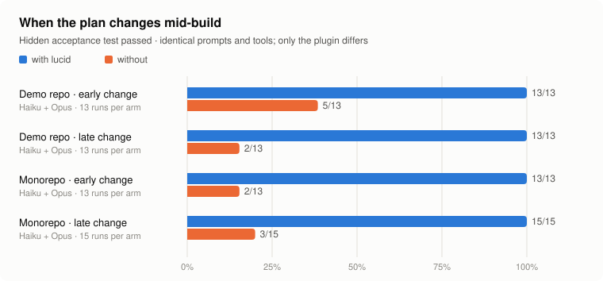
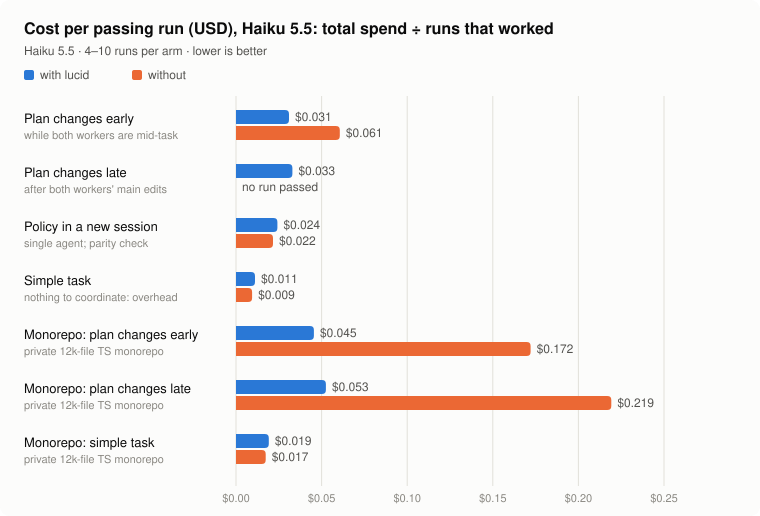
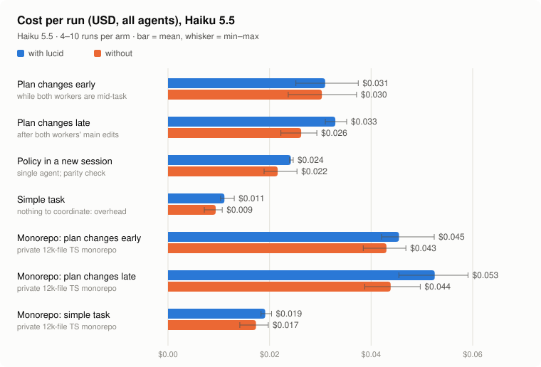

<p align="center">
  
</p>

<h1 align="center">lucid</h1>

<p align="center">
  <b>One shared dream for every Claude.</b><br>
  A live plan, an evidence-backed memory and file claims shared by the lead agent, its subagents and Agent-Teams teammates.<br>
  Change the plan partway through and every running worker sees the change before its next action.<br>
  Plus <b>team rules</b> every agent is checked against, learned from corrections and PR reviews, approved in a PR.
</p>

<p align="center">
  <a href="https://lucid.meertarbani.in"></a>
  <a href="https://code.claude.com/docs/en/plugins/overview"></a>
  
  
  <a href="https://github.com/Redskull-127/lucid/actions/workflows/test.yml"></a>
  <a href="LICENSE"></a>
</p>

<p align="center">
  <a href="#-install">Install</a> ·
  <a href="#-how-it-works">How it works</a> ·
  <a href="#-team-rules">Team rules</a> ·
  <a href="#-benchmark">Benchmark</a> ·
  <a href="#-commands">Commands</a> ·
  <a href="#-seen-in-a-real-run">Real run</a> ·
  <a href="#-honest-limits">Limits</a>
</p>

---

## 🌙 The problem

You build a feature with several Claude agents working at once, then change your mind partway through. Things go wrong:

| Symptom | Why it happens |
|---|---|
| 🧭 **Plan drift** | Workers that are already running still follow the plan they were spawned with. Nothing tells them it changed. |
| 📉 **Lossy handoffs** | A subagent's summary leaves out the *why*, and leaves out the *"we tried X, it broke"*. |
| 🔁 **Repeated work** | Every worker re-reads and re-searches the same code. |
| 🫥 **Compaction amnesia** | Decisions disappear when the conversation is compacted and in new sessions. |
| 💥 **Overwritten work** | Two agents edit the same file and one loses its changes. |

## ✨ What lucid does

lucid gives every agent in the project **one shared memory**, the dream, kept as plain files in `.lucid/`:

| File | What it holds |
|---|---|
| `plan.md` | **The live plan.** When anyone edits it, every running agent gets the diff before its next tool call. |
| `log.jsonl` | **An append-only memory:** decisions (with why), facts (with `path:line` evidence), dead ends, blockers and file claims. |
| `digest.md` | **A consolidated summary**, written when you run `/lucid:dream`. |

The memory is wired in through hooks, so agents can't forget to check it. Agents only add to the log and never rewrite it. A fact whose cited code has changed is flagged **⚠stale**, so shared memory doesn't spread outdated claims.

## 🔭 How it works

<picture>
  <source media="(prefers-color-scheme: dark)" srcset="assets/how-it-works-dark.svg">
  
</picture>

| Hook | What it does |
|---|---|
| **SessionStart** (also after `/compact`) · **SubagentStart** | Injects the plan, the live memory and active claims, within a fixed budget. Subagents and Agent-Teams teammates start with the full shared context instead of a one-paragraph brief. |
| **UserPromptSubmit** · **PreToolUse** | Injects only what *other* agents wrote since you last looked. When nothing changed it injects nothing and costs no tokens. |
| **PreToolUse** on edits | 🔒 Blocks a write to a file another active agent has claimed, whether it goes through Edit/Write or through Bash (`>`, `sed -i`, `cp`/`mv`, scripts that `open(…, 'w')`). |
| **PreToolUse** on Bash | Adds the calling agent's real id to every `lucid` command, so every entry records who wrote it and agents never have to manage ids. |
| **SubagentStop** · **TaskCompleted** | Asks once for notes from an agent that edited files but logged nothing. A stopping subagent's claims are released. |
| **Stop** · **SessionEnd** | Releases a session's claims when its turn or the session ends, so an idle agent never blocks others. |
| **UserPromptSubmit** while workers are busy | Reminds the lead to write a chat change of plan into `plan.md` first, so running workers get it and it survives `/compact`. |

> **You never have to name lucid.** Every session starts with a few lines on when it helps, so Claude runs `/lucid:swarm` before parallel agents edit files, `/lucid:replan` when you change the plan mid-build, and `lucid learn` when you state a standing convention. In a live test with no `.lucid/` and a prompt that only asked for two tasks done by two subagents in parallel, Claude ran `lucid init`, wrote the plan, logged two shared decisions and had its workers claim their files. The rest of lucid stays inactive until a project has `.lucid/`: before that, a tiny shell guard exits on every other hook without starting Python. It works from repo subfolders and git worktrees, which share the main checkout's dream.

## 📏 Team rules

Teams keep their conventions, review checks and hard-won lessons in AGENTS.md or CLAUDE.md. Agents read those files, but nothing makes them follow every rule:
- **Each rule is usually followed, but rarely all of them.** In [OctoBench](https://arxiv.org/abs/2601.10343), 80–86% of individual rule checks pass, but only 10–28% of tasks follow every rule, and it gets worse as sessions get longer.
- **The files are advisory by design.** Anthropic's [docs](https://code.claude.com/docs/en/memory) say Claude "treats them as context, not enforced configuration."
- **What one developer teaches their agent stays on their machine.** Claude Code's auto memory is machine-local.

lucid builds on Claude Code's own path-scoped rule files, `.claude/rules/*.md`, which load when an agent touches a matching file. It adds two optional keys that Claude Code ignores:

```markdown
---
paths: ["src/api/**/*.ts"]
forbid: 'console\.log\('   # lines an agent ADDS must not match
review: true               # checked against the diff before the agent finishes a turn
---
# Log through logger, never console
Every API handler logs through src/lib/logger.ts so request ids are kept.
```

| | What happens |
|---|---|
| **`forbid`** | When an edit adds a matching line, the agent gets the hit with the edit's result and fixes it or says why it's an exception. Lines that were already there never count. |
| **`review: true`** | Before the agent ends a turn that touched matching files, it's asked once to read its diff against these rules and answer ✓ or ✗ per rule. Subagents too. |
| **Learning** | A correction in chat ("we never…", "from now on…"), PR review threads (`/lucid:learn pr 412`, `/lucid:learn recent 30`), and `/lucid:dream` become proposals in `.lucid/proposed/`. They do nothing until a PR moves them into `.claude/rules/`, so the team reviews each rule like code. |
| **Stats** | `lucid rules` shows each rule's matches, `forbid` hits, unresolved hits and review rounds, plus rules that never matched an edit. |
| **Other tools** | `lucid rules export` writes the rules into a marked AGENTS.md block for Codex, Copilot, Cursor and review bots. `--check` fails CI on drift. |

**Cautious by default.** Nothing blocks a write. Every reminder is capped. Rules are regexes, never shell commands, so a PR can't slip a command into your agents' hooks. lucid never commits or pushes. `LUCID_RULES=observe` records stats without showing agents anything, so a team can watch a week for false positives before turning it on.

**What the benchmark shows: no adherence gain yet.** In 115 runs on Haiku and Opus, every arm followed every rule: 30 rules in one long CLAUDE.md, the same rules as native `.claude/rules/` files, and the same files under lucid. That held in a 7-turn session where the rules mattered again after 80 KB of docs had been read. A teammate session with none of the first session's memory also picked up a chat-stated policy in every run without lucid, because Claude wrote it into a CLAUDE.md itself. lucid cost 5–32% more per run, mostly for the review round. So lucid didn't make Claude follow rules better on these tasks. What it adds is:
- a mechanical check that runs anyway,
- a record of what each rule caught,
- a reviewed path from correction to rule (Claude ran `lucid learn` unprompted in 11 of 13 runs),
- one set of rules for every tool.

Keep `review: true` for the few rules worth a review round. [Results below](#team-rules-05) · [Team rules docs](https://lucid.meertarbani.in/docs/team-rules).

## 📊 Benchmark

The same tasks run **with and without lucid**, on **Claude Haiku 5.5 and Claude Opus 5.5** through headless `claude -p`, in two codebases: a small demo repo and a **private 12k-file, ~950k-line TypeScript monorepo**. Everything else is identical: the prompts, the tools, a fresh checkout per run, and project settings only (no personal plugins, hooks or CLAUDE.md). A hidden acceptance test the agents never see scores the final code. The 146 runs shown cost $58.77 in total.

<picture>
  <source media="(prefers-color-scheme: dark)" srcset="assets/bench-headline-dark.svg">
  
</picture>

<picture>
  <source media="(prefers-color-scheme: dark)" srcset="assets/bench-parity-dark.svg">
  
</picture>

- **Plan changes early:** two workers run in parallel, and you edit `PLAN.md` at the first worker edit.
- **Plan changes late:** the same, but the edit lands after both workers' main edits.
- **Policy in a new session:** session 1 hears an unwritten policy, and a fresh session 2 must follow it.
- **Simple task:** one agent, nothing to coordinate. This measures the overhead.
- **Monorepo rows:** the same design in the private monorepo, with the two workers editing modules in two different packages. The repo isn't named and no code from it is published.

| Scenario | Model | with lucid | without |
|---|---|---|---|
| Plan changes early | Haiku 5.5 | **8/8** · $0.031 | 4/8 · $0.030 |
| | Opus 5.5 | **5/5** · $1.01 | 1/5 · $0.91 |
| Plan changes late | Haiku 5.5 | **8/8** · $0.033 | **0/8** · $0.026 |
| | Opus 5.5 | **5/5** · $1.06 | 2/5 · $0.94 |
| Policy in a new session | Haiku 5.5 | 4/4 · $0.024 | 4/4 · $0.022 |
| Simple task | Haiku 5.5 | 4/4 · $0.011 | 4/4 · $0.009 |
| | Opus 5.5 | 3/3 · $0.37 | 3/3 · $0.35 |
| Monorepo: plan changes early | Haiku 5.5 | **8/8** · $0.045 | 2/8 · $0.043 |
| | Opus 5.5 | **5/5** · $1.60 | **0/5** · $1.42 |
| Monorepo: plan changes late | Haiku 5.5 | **10/10** · $0.053 | 2/10 · $0.044 |
| | Opus 5.5 | **5/5** · $1.58 | 1/5 · $1.53 |
| Monorepo: simple task | Haiku 5.5 | 5/5 · $0.019 | 5/5 · $0.017 |
| | Opus 5.5 | 3/3 · $0.55 | 3/3 · $0.55 |

Cells show runs passed and mean cost per run.

<picture>
  <source media="(prefers-color-scheme: dark)" srcset="assets/bench-costpass-opus-dark.svg">
  
</picture>

<picture>
  <source media="(prefers-color-scheme: dark)" srcset="assets/bench-costpass-haiku-dark.svg">
  
</picture>

**What it shows**
- **Plan changes mid-build: 54/54 with lucid, 12/54 without, across both models and both codebases.** Without lucid, Haiku missed every late change in the demo repo (0/8). Opus did better by re-checking the plan at the end (2/5), but still missed most changes. With lucid, the diff arrives before each worker's next tool call.
- **It holds in a large real codebase.** In the private 12k-file monorepo, workers without lucid missed the mid-task change in 23 of 28 runs, and with lucid all 28 passed. Even Opus missed it 9 times out of 10 without lucid. Each run cost 4–20% more.
- **Cheaper per working result.** lucid runs cost 2–26% more, mostly because they do the extra work the change requires (see *Why lucid runs cost a bit more* below). Per *passing* run they cost about half as much on Haiku ($0.031 vs $0.061). On Opus they cost $1.01 vs $4.57 for early changes and $1.06 vs $2.35 for late ones.
- **Plan changed by chatting with the lead: parity, 3/3 vs 3/3.** In live tmux sessions, a lead without lucid relayed the change to its workers or applied it itself. lucid's edge is for changes that don't pass through the lead's chat: you editing the plan, another agent, or another session. It also makes chat changes persist: when workers are active, lucid asks the lead to write the change into `plan.md`, where it survives `/compact`.
- **One agent across sessions: parity.** Claude Code's built-in memory already carries the policy forward. lucid matches it; it doesn't beat it.
- **Overhead when there's nothing to coordinate:** +$0.002 and about +4–5 s per run on Haiku (+11–18%, in both codebases), and +$0.026 (+7%) and +6 s on Opus in the demo repo. In the monorepo, Opus showed no measurable overhead ($0.55 vs $0.55, 22 s vs 22 s). Almost all of the overhead is bookkeeping calls (see below).
- **It found a lucid bug.** The first memory run failed 1 of 4 because a finished session's file claim blocked the next session. Claims now release on `SessionEnd`, and the scenario was rerun.

### Why runs without lucid fail

All 42 failed runs were without lucid, and in every one the original tasks were done correctly. The only thing missing was the mid-task change: nothing told a running worker that the plan had changed.

| | Who | What happens without lucid |
|---|---|---|
| 1 | Lead | Reads `PLAN.md`, writes briefs, spawns workers A and B. |
| 2 | Workers | Read their brief (a snapshot) and work from what's in their context. |
| 3 | **You** | **Edit `PLAN.md` mid-task. Nothing tells anyone.** |
| 4 | Workers | Finish the *original* task and report "done". |
| 5 | Lead | Sees "done" from both and reports success. **✗ The change is missing.** |

1. **Workers work from a snapshot.** The plan reaches each worker in its brief, or in one read of `PLAN.md` at the start. After that the worker works from its context. Agents don't re-open files they've already read unless something gives them a reason, so a changed file on disk goes unseen.
2. **Nothing signals the change.** Claude Code doesn't watch files for agents, and editing a file doesn't interrupt anyone.
3. **The lead trusts the reports.** Workers report "done", which is true of the task they were given. The lead has no reason to re-check the plan, so it reports success.

**Why some runs without lucid still passed (12 of 54).** Luck in timing, or extra checking. Early changes were caught more often (5 of 13 on the demo repo, against 2 of 13 for late ones), because a worker that happens to re-open `PLAN.md` mid-task sees the new line. Opus sometimes re-checked the plan at the end and fixed the work itself. That's why those successes cost more and took longer: $1.68 and 115 s, against lucid's $1.58 and 76 s on the same scenario.

**What lucid changes.** Before every tool call, its hook checks whether the plan changed. If it did, the diff goes straight into that agent's context, with a note that the plan overrides its original brief. The worker sees the change before its next edit and applies it, without relying on luck or the lead.

**Cost per working result.** A failed run means the code shipped without your change. In practice you'd notice later and pay for another round of agent work. So the fair comparison divides total spend, failed runs included, by the runs that actually worked:

| Plan changes mid-build | with lucid | without | |
|---|---|---|---|
| Haiku 5.5 | $0.041 (34 of 34 passed) | $0.154 (8 of 34 passed) | **3.7× cheaper** |
| Opus 5.5 | $1.31 (20 of 20 passed) | $6.00 (4 of 20 passed) | **4.6× cheaper** |

Per run, lucid costs 10–13% more, because it does the extra work the change requires. Some per-scenario baselines rest on one or two passing runs, so the overall figures above are the stable ones.

<details>
<summary>Results by model, raw cost and time per run</summary>

<picture>
  <source media="(prefers-color-scheme: dark)" srcset="assets/bench-success-dark.svg">
  
</picture>

**Why lucid runs cost a bit more and take a bit longer**, measured from the run transcripts:

1. **They do the work the change requires.** Most of the gap in the plan-change scenarios is work the baseline skipped: a failing run never applies the change. Compare only runs that passed:

   | | with lucid | without, passing runs only |
   |---|---|---|
   | Haiku, plan changes early | $0.031 · 46 s | $0.035 · 54 s |
   | Opus, plan changes early | $1.006 · 49 s | $0.987 · 58 s |
   | Opus, plan changes late | $1.064 · 57 s | $1.044 · 74 s |
   | Monorepo (Haiku), plan changes early | $0.045 · 49 s | $0.046 · 52 s |
   | Monorepo (Haiku), plan changes late | $0.053 · 57 s | $0.048 · 58 s |
   | Monorepo (Opus), plan changes late | $1.580 · 76 s | $1.682 · 115 s |

   When the baseline gets it right, it costs about the same and takes longer, because the lead discovers the change late and the work gets redone.
2. **Bookkeeping calls.** Agents run short `lucid` commands to claim files and log decisions. That's about 9 per run with two workers, and about 5 even on the trivial single-agent task (10 tool calls vs 6). Each call is cheap but costs a model turn. On the simple task this is the whole overhead: +$0.002 on Haiku, +$0.026 on Opus, and +5–6 s.
3. **Injected context is small.** Hooks added about 340 characters per simple run, and about 4,700 characters (around 1,200 tokens) across all agents in a two-worker run. Each run processes 0.6–1 million tokens, mostly prompt-cache reads. Hook latency is about 25 ms per tool call, roughly 1 s per run.


<picture>
  <source media="(prefers-color-scheme: dark)" srcset="assets/bench-cost-opus-dark.svg">
  
</picture>

<picture>
  <source media="(prefers-color-scheme: dark)" srcset="assets/bench-time-opus-dark.svg">
  
</picture>

<picture>
  <source media="(prefers-color-scheme: dark)" srcset="assets/bench-cost-haiku-dark.svg">
  
</picture>

<picture>
  <source media="(prefers-color-scheme: dark)" srcset="assets/bench-time-haiku-dark.svg">
  
</picture>

</details>

### Team rules (0.5)

Do agents follow team rules better with lucid? Three arms got the same 30 rules, 3 of which applied to the task, and an identical prompt that never mentioned them:
- **one CLAUDE.md** holding all 30 rules;
- **native**: the same rules as `.claude/rules/` files, which Claude Code loads by path;
- **lucid**: the same rule files plus the plugin.

The three rules that applied were: log through `shop.log`, never `print()` (a `forbid` rule); money functions reject negative amounts; and every public function has a docstring (both `review` rules). A hidden test checked the task and all three rules.

| Scenario | Model | lucid | native rules | one CLAUDE.md |
|---|---|---|---|---|
| One task, 4 changes | Haiku 5.5 | 8/8 · $0.018 · 36 s | 8/8 · $0.014 · 24 s | 8/8 · $0.014 · 23 s |
| | Opus 5.5 | 5/5 · $0.49 · 50 s | 5/5 · $0.47 · 47 s | 5/5 · $0.44 · 39 s |
| 7-turn session (rules matter in turns 1, 6, 7) | Haiku 5.5 | 8/8 · $0.77 · 114 s | 8/8 · $0.58 · 81 s | 8/8 · $0.60 · 80 s |
| Simple task, rules present | Haiku 5.5 | 8/8 · $0.014 · 21 s | 8/8 · $0.012 · 16 s | |
| | Opus 5.5 | 5/5 · $0.46 · 40 s | 5/5 · $0.41 · 34 s | |

| Teammate picks up a policy stated in chat | Model | lucid | without lucid |
|---|---|---|---|
| A fresh session, with none of the first session's memory | Haiku 5.5 | 8/8 · $0.022 (`lucid learn` unprompted in 6/8) | 8/8 · $0.024 |
| | Opus 5.5 | 5/5 · $0.76 (`lucid learn` unprompted in 5/5) | 5/5 · $0.76 |

Cells show runs passed, mean cost and mean time per run. The 115 runs cost $35.49.

- **No adherence gain on these tasks.** Every arm passed every run, including a single 30-rule CLAUDE.md, on both models and across a 7-turn session.
- **The cost is the review round:** +$0.004 and +12 s per run on Haiku (+29%), +$0.025 and +3 s on Opus (+5%), and +$0.19 and +33 s (+32%) over the 7-turn session.
- **The learning loop works unprompted.** Nothing in the prompt mentioned lucid, yet Claude proposed the policy as a team rule in 11 of 13 lucid runs. Without lucid, Claude wrote the policy into a new CLAUDE.md itself in all 13 runs, so the teammate passed either way. The difference is the format: an unscoped CLAUDE.md note, or a path-scoped rule proposal that waits for review.
- **Untested:** hundreds of rules, sessions long enough to compact, large repos, and rules a model is less inclined to follow. That's where the research finds agents slip.

To reproduce, run `python3 bench/run.py --scenarios rules,rules-long,teammate,rules-control --runs 8 -j 4` (Haiku, about $17, mostly the 7-turn session).

To reproduce the plan-change results, run `python3 bench/run.py --runs 8 -j 4` (Haiku, about $1.50), or add `--model opus --budget 30` (about $1 per run). Then run `python3 bench/chart.py`. Raw results are in [`bench/results.jsonl`](bench/results.jsonl). The monorepo rows came from a private harness that names files in that repo, so they can't be reproduced from here. Their raw rows are included, anonymized. The samples are small (3–10 runs per arm). To keep spend down, the memory scenario ran on Haiku in the demo repo only. Treat this as a strong signal, not a paper.

## 📦 Install

```text
/plugin marketplace add Redskull-127/lucid
/plugin install lucid@lucid
```

That's all. Claude sets lucid up in a project the first time it helps: `lucid init` before a swarm, or `lucid learn` for the first team rule (the plugin puts `lucid` on Claude's PATH). To start one yourself, run `/lucid:swarm <feature>`, or ask Claude to run `lucid init` and write your plan in `.lucid/plan.md`.

<details>
<summary>Develop or try a local checkout</summary>

```bash
git clone https://github.com/Redskull-127/lucid
claude --plugin-dir ./lucid       # load for one session; /reload-plugins after edits
python3 lucid/test_lucid.py       # self-check
claude plugin validate ./lucid --strict
```
</details>

## 🪄 Commands

| Command | What it does |
|---|---|
| `/lucid:swarm <feature>` | Writes the plan, splits the work by file ownership, settles shared decisions up front, then spawns workers that share the dream. |
| `/lucid:replan <change>` | Changes direction mid-build. Running workers get the diff before their next action. |
| `/lucid:dream` | Consolidates a long memory: merges duplicates, retires stale entries, and proposes lasting lessons as team rules. Suggested after `lucid end`. |
| `/lucid:learn [pr N \| recent N \| import \| promote]` | Turns corrections, PR review threads and an existing CLAUDE.md or AGENTS.md into team rules, and walks proposals through to a PR. |

You can run these yourself, but you don't have to: Claude starts them when they fit.

**CLI** (on the agents' PATH, and usable from your own terminal, where your notes reach agents as coming from `human`):

```bash
lucid note decision "use JWT, not sessions, because the API is stateless" -e src/auth.ts:42
lucid note failed   "bcrypt native build breaks on Node 24; use bcryptjs"
lucid note blocker  "need the DB schema from the migrations worker"
lucid claim 'src/db/**' --for "migrations"     # release when done
lucid supersede 12 --why "switched to sessions"
lucid status        # the digest agents see
lucid log --since 40
lucid wait          # the lead runs this in the background: it returns when a worker logs a blocker
lucid end           # the swarm is done: swarm hooks go quiet, plan and log stay (`lucid init` archives them)
lucid learn "never use moment.js; use date-fns" --paths 'src/**' --source pr#412   # propose a team rule
lucid rules         # team rules with this machine's stats; `lucid rules export [--check]` for AGENTS.md
```

> 💡 For parallel **full** Claude instances, enable Claude Code's Agent Teams with `CLAUDE_CODE_EXPERIMENTAL_AGENT_TEAMS=1`. lucid doesn't spawn agents itself; it keeps the ones Claude Code spawns in sync.

## 🎬 Seen in a real run

This used `claude -p` on Haiku. A subagent was spawned to work through the plan, and its brief never mentioned `multiply()`. While it worked, a human appended one line to `.lucid/plan.md`. Before the worker's next tool call, this was injected:

```text
[lucid] 1 update(s) from other agents since you last looked:
#3 PLAN CHANGED by user:
@@ -3 +3,2 @@
 - add a one-line docstring to every function in calc.py
+- ALSO add multiply() to calc.py
```

The worker added `multiply()`. In the same run, it logged a note before it had finished, so the note was out of date. lucid flagged it **⚠stale** because the cited file had changed since, and the lead agent pointed out the inaccuracy.

**Two workers in parallel.** `/lucid:swarm` split a task into `shop/pricing.py` and `shop/cart.py`, one worker each. The moment the cart worker claimed its file, a human added a requirement spanning both files: *"`Cart.total()` must apply `discount()` over 100"*. The cart worker got the diff mid-task, applied it itself, and logged the decision. Both claims were released automatically. A hidden acceptance test the agents never saw passed 4/4.

**Agent Teams, live in tmux.** With `CLAUDE_CODE_EXPERIMENTAL_AGENT_TEAMS=1`, the lead picked `/lucid:swarm` on its own and spawned `@pricing-worker` and `@cart-worker` as in-process teammates. lucid's hooks fired inside both teammates: start, every tool call, plan edits and stop, each under the teammate's own id. Both claimed, worked, logged and were auto-released. In split-pane mode, where each teammate is a separate `claude` process, lucid loads too. There, teammates appear under their session id, and their claims release when their turn ends.

**Real `/compact`.** After a compaction, the lead quoted a log entry word for word (*"COMPACT-PROBE: store every price as integer cents; zebra-42"*). It came from the dream that lucid re-injects after `/compact`, not from the summary.

These runs uncovered three bugs, all fixed:
- Leads invented worker ids, so lucid now stamps every agent's real id on its `lucid` commands.
- One worker obeyed its stale brief over the plan change, so plan changes now state that they override the original brief.
- A teammate edited through a Python heredoc in Bash, which skipped claims and the stop gate. File writes made through Bash are now checked too.

**A real feature in a private 12k-file monorepo.** A lead and three workers built role-based access across the schema, services, API, MCP server and UI: 136 files, built in parallel in 35 minutes. Two things carried it:
- The lead logged six contract decisions before spawning anyone. None of the six bugs the later review found sat on a seam between two workers.
- When one worker reformatted the whole repo by accident, a single STOP line in `plan.md` reached the other two before their next tool call.

The run also showed where lucid fell short. Version 0.4 fixes each of these:
- **Claims didn't notice the repo-wide format.** A formatter run with an empty file list touched 675 files, and only a human caught it. Now each Bash call in a swarm is compared against `git status`. If one command changes many unclaimed files, that raises a blocker carrying a one-command `git restore`. The restore only touches files that had no uncommitted edits.
- **A worker's blocker waited 19 minutes** because the lead had gone idle. The lead now runs `lucid wait` in the background, which wakes it when a blocker arrives.
- **Review agents filed unverified findings as facts.** Agents that only read are now told not to write. Their notes are tagged `reader` and drop out once the code they cite changes.
- **The plan was cut off mid-Constraints.** Long plans now lose task file lists first. Goal and Constraints always come through whole.
- **⚠stale fired on edits hundreds of lines away.** It now tracks the cited lines, not the whole file.
- **Checkbox ticks made with `sed` were credited to the user** and read as new orders. They're now credited to the agent that made them and shown as progress.
- **After the build, 2.5 hours of solo review rounds still got notes.** `lucid end` turns the hooks off.

## 🧭 When to use it

**Use it for:** three or more agents building at once; work that splits cleanly by file; interfaces you can decide before spawning anyone; a plan likely to change mid-build.

**Skip it for:** one agent working through review comments; agents that only read or review; tasks where writing the plan costs more than it saves.

lucid makes the parts fit together. It doesn't make them correct, so keep the review step.

## 🧪 Honest limits

- **More agents still means more tokens.** lucid cuts repeated exploration and re-explaining, not the cost of running each instance.
- **Parallelism helps decoupled work.** Keep tightly coupled changes with a single agent; `/lucid:swarm` says so too.
- **Single agent across sessions:** Claude Code's built-in auto-memory already carries a policy into the next session, and the benchmark shows parity there. lucid earns its keep when **several agents work at once**.
- **Bash write detection is a heuristic.** It catches redirects, `tee`, `cp`/`mv`/`rm`, `sed -i` and Python writes, but not every way a program can write a file. During a swarm, a `git status` taken before and after each Bash call catches the rest after the fact. That adds about 0.2 s per Bash call on a 12k-file repo, and only while a swarm holds claims. If another agent writes during that window, the write may be blamed on the caller.
- **Team-rule reviews are the agent checking itself.** A review round is a prompt, not proof, so keep human review and CI for what must hold. `forbid` is checked mechanically, but only on Edit, Write and MultiEdit text; Bash writes are covered by the review round.
- **Rule checks run inside Claude Code only.** Other tools get the same rules as AGENTS.md text. Rule stats are per machine.
- **POSIX only** (macOS and Linux), because the log uses `flock` for locking.

## ⚙️ Configuration

| Variable | Default | Meaning |
|---|---|---|
| `LUCID_CLAIM_TTL` | `1200` | Seconds without activity from a claim's owner before the claim lapses. |
| `LUCID_STRAY_ALARM` | `20` | Unclaimed files that one Bash command may change before lucid raises a blocker for everyone. |
| `LUCID_ROOT` | project dir | Where `.lucid/` lives, for worktrees outside the repo. |
| `LUCID_RULES` | `on` | Team rules: `on`, `observe` (record stats, show agents nothing) or `off`. |
| `LUCID_DEBUG` | unset | `1` logs every hook input to `.lucid/.debug.jsonl`. |

Commit `plan.md`, `log.jsonl` and `digest.md` so teammates and future sessions share the dream, and `.claude/rules/` and `.lucid/proposed/` for team rules. Per-agent state and rule stats are git-ignored automatically.

To offer the plugin to everyone who opens the repo, commit this to `.claude/settings.json` (organization admins can force it with managed settings):

```json
{
  "extraKnownMarketplaces": { "lucid": { "source": { "source": "github", "repo": "Redskull-127/lucid" } } },
  "enabledPlugins": { "lucid@lucid": true }
}
```

---

<p align="center">
  Made by <a href="https://www.meertarbani.in">Meer Tarbani</a> · <a href="LICENSE">MIT</a>
</p>
