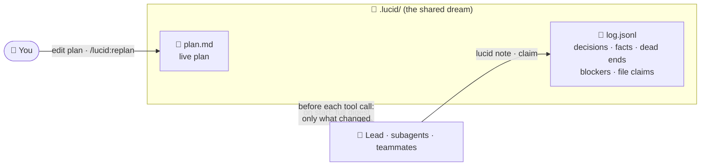

<p align="center">
  
</p>

<h1 align="center">lucid</h1>

<p align="center">
  <b>One shared dream for every Claude.</b><br>
  A live plan, an evidence-backed memory and file claims shared by the lead agent, its subagents and Agent-Teams teammates.<br>
  Change the plan partway through and every running worker sees the change before its next action.
</p>

<p align="center">
  <a href="https://lucid.meertarbani.in"></a>
  <a href="https://code.claude.com/docs/en/plugins/overview"></a>
  
  
  <a href="LICENSE"></a>
</p>

<p align="center">
  <a href="#-install">Install</a> ·
  <a href="#-how-it-works">How it works</a> ·
  <a href="#-commands">Commands</a> ·
  <a href="#-seen-in-a-real-run">Real run</a> ·
  <a href="#-honest-limits">Limits</a>
</p>

---

## 🌙 The problem

You build a feature with several Claude agents working at once, then change your mind partway through. Things go wrong:

| Symptom | Why it happens |
|---|---|
| 🧭 **Plan drift** | Workers that are already running still follow the plan they were spawned with. Nothing tells them it changed. |
| 📉 **Lossy handoffs** | A subagent's summary leaves out the *why*, and leaves out the *"we tried X, it broke"*. |
| 🔁 **Repeated exploration** | Every worker re-reads and re-searches the same code. |
| 🫥 **Lost after `/compact`** | Decisions disappear when the conversation is compacted and in new sessions. |
| 💥 **Overwritten work** | Two agents edit the same file and one loses its changes. |

## ✨ What lucid does

lucid gives every agent in the project **one shared memory**, the dream, kept as plain files in `.lucid/`:

| File | What it holds |
|---|---|
| 📜 `plan.md` | **The live plan.** When anyone edits it, every running agent gets the diff before its next tool call. |
| 🧠 `log.jsonl` | **An append-only memory:** decisions (with why), facts (with `path:line` evidence), dead ends, blockers and file claims. |
| 💤 `digest.md` | **A consolidated summary**, written when you run `/lucid:dream`. |

The memory is wired in through hooks, so agents can't forget to check it. Agents only add to the log and never rewrite it. A fact whose cited code has changed is flagged **⚠stale**, so shared memory doesn't spread outdated claims.

## 🔭 How it works



| Hook | What it does |
|---|---|
| **SessionStart** (also after `/compact`) · **SubagentStart** | Injects the plan, the live memory and active claims. Subagents start with the full shared context instead of a one-paragraph brief. |
| **UserPromptSubmit** · **PreToolUse** | Injects only what *other* agents wrote since you last looked. When nothing changed it injects nothing and costs no tokens. |
| **PreToolUse** on edits | 🔒 Blocks an edit to a file that another active agent has claimed. |
| **PreToolUse** on Bash | Adds the calling agent's real id to every `lucid` command, so every entry records who wrote it and agents never have to manage ids. |
| **SubagentStop** · **TaskCompleted** | Asks once for notes from an agent that edited files but logged nothing. A stopping subagent's claims are released. |

> lucid stays **inactive** until a project opts in with `lucid init`. In every other project the hooks only run a quick check that `.lucid/` doesn't exist.

## 📦 Install

```text
/plugin marketplace add Redskull-127/lucid
/plugin install lucid@lucid
```

Then, in your project:

```bash
lucid init        # creates .lucid/ ; write your plan in .lucid/plan.md
```

<details>
<summary>Develop or try a local checkout</summary>

```bash
git clone https://github.com/Redskull-127/lucid
claude --plugin-dir ./lucid       # load for one session; /reload-plugins after edits
python3 lucid/test_lucid.py       # self-check
claude plugin validate ./lucid --strict
```
</details>

## 🪄 Commands

| Command | What it does |
|---|---|
| `/lucid:swarm <feature>` | Writes the plan, splits the work by file ownership, settles shared decisions up front, then spawns workers that share the dream. |
| `/lucid:replan <change>` | Changes direction mid-build. Running workers get the diff before their next action. |
| `/lucid:dream` | Consolidates a long memory: merges duplicates, retires stale entries, and suggests lessons for CLAUDE.md. Runs only when you invoke it. |

**CLI** (on the agents' PATH, and usable from your own terminal, where your notes reach agents as coming from `human`):

```bash
lucid note decision "use JWT, not sessions, because the API is stateless" -e src/auth.ts:42
lucid note failed   "bcrypt native build breaks on Node 24; use bcryptjs"
lucid note blocker  "need the DB schema from the migrations worker"
lucid claim 'src/db/**' --for "migrations"     # release when done
lucid supersede 12 --why "switched to sessions"
lucid status        # the digest agents see
lucid log --since 40
```

> 💡 For parallel **full** Claude instances, enable Claude Code's Agent Teams with `CLAUDE_CODE_EXPERIMENTAL_AGENT_TEAMS=1`. lucid doesn't spawn agents itself; it keeps the ones Claude Code spawns in sync.

## 🎬 Seen in a real run

This used `claude -p` on Haiku. A subagent was spawned to work through the plan, and its brief never mentioned `multiply()`. While it worked, a human appended one line to `.lucid/plan.md`. Before the worker's next tool call, this was injected:

```text
[lucid] 1 update(s) from other agents since you last looked:
#3 PLAN CHANGED by user:
@@ -3 +3,2 @@
 - add a one-line docstring to every function in calc.py
+- ALSO add multiply() to calc.py
```

The worker added `multiply()`. In the same run, it logged a note before it had finished, so the note was out of date. lucid flagged it **⚠stale** because the cited file had changed since, and the lead agent pointed out the inaccuracy.

**Two workers in parallel.** `/lucid:swarm` split a task into `shop/pricing.py` and `shop/cart.py`, one worker each. The moment the cart worker claimed its file, a human added a requirement spanning both files: *"`Cart.total()` must apply `discount()` over 100"*. The cart worker got the diff mid-task, applied it itself, and logged the decision. Both claims were released automatically. A hidden acceptance test the agents never saw passed 4/4.

These runs also uncovered two bugs, both fixed:
- Leads invented worker ids, so lucid now stamps every agent's real id on its `lucid` commands.
- One worker obeyed its stale brief over the plan change, so plan changes now state that they override the original brief.

## 🧪 Honest limits

- **More agents still means more tokens.** lucid cuts repeated exploration and re-explaining, not the cost of running each instance.
- **Parallelism helps decoupled work.** Keep tightly coupled changes with a single agent; `/lucid:swarm` says so too.
- **Agent Teams:** subagent hooks are verified. Whether plugin hooks fire inside in-process teammates isn't documented yet. If they don't, teammates can still use the CLI and skill by hand.
- **POSIX only** (macOS and Linux), because the log uses `flock` for locking.

## ⚙️ Configuration

| Variable | Default | Meaning |
|---|---|---|
| `LUCID_CLAIM_TTL` | `1200` | Seconds without activity from a claim's owner before the claim lapses. |
| `LUCID_ROOT` | project dir | Where `.lucid/` lives, for worktrees outside the repo. |
| `LUCID_DEBUG` | unset | `1` logs every hook input to `.lucid/.debug.jsonl`. |

Commit `plan.md`, `log.jsonl` and `digest.md` so teammates and future sessions share the dream. Per-agent state is git-ignored automatically.

---

<p align="center">
  Made by <a href="https://www.meertarbani.in">Meer Tarbani</a> · <a href="LICENSE">MIT</a>
</p>
